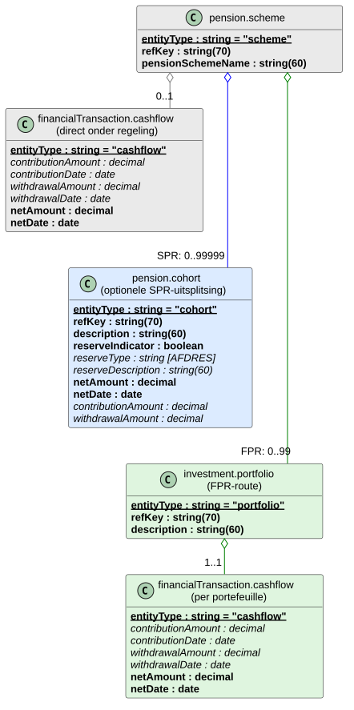
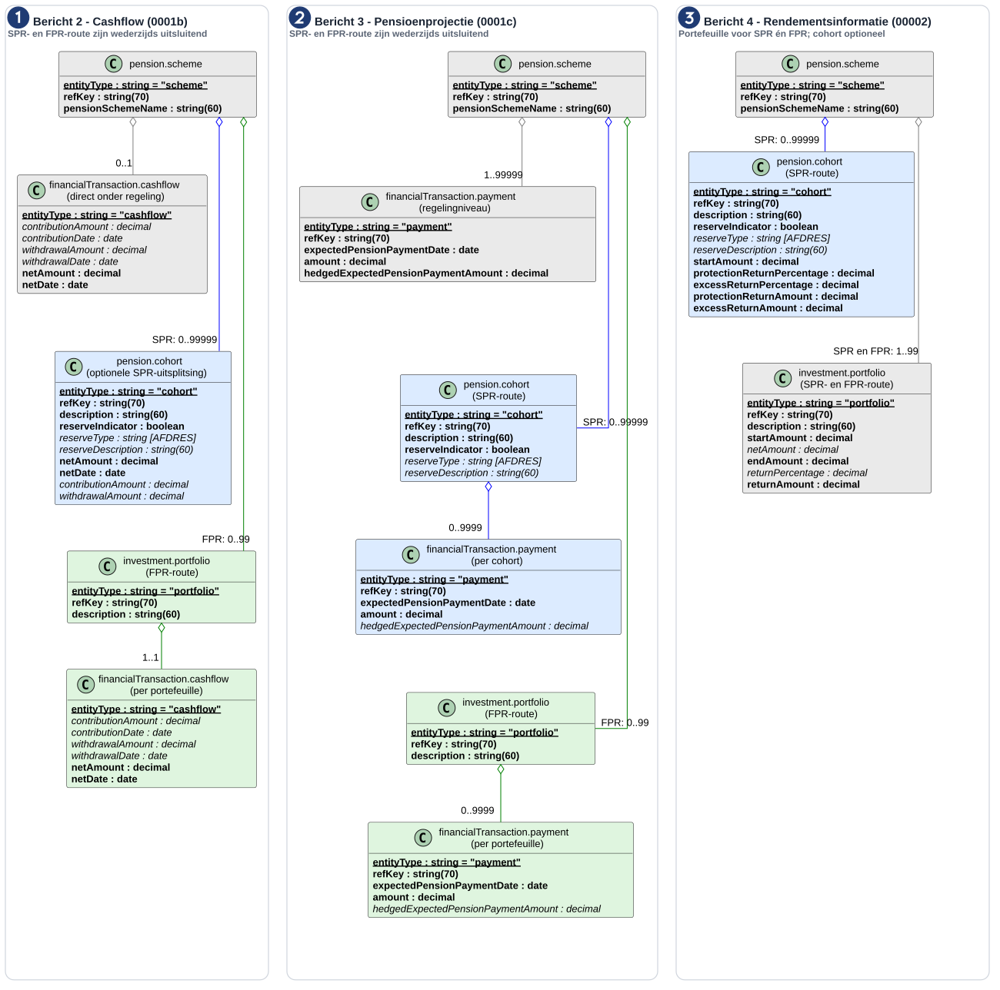

# 3 Processes & Information Flows – Solidarity Premium Scheme

## 3.1 Introduction

This section describes the information exchange between the parties involved that is needed to implement the Solidarity Premium Scheme in a robust way[^1].

Figure 1 below shows the information exchange between the parties involved schematically. The investment administrator (BA) provides the pension administration organisation (PUO) with information independently of the fiduciary manager (FM) and can also perform a reviewing role. If that option is not chosen and the fiduciary manager also keeps the leading investment administration, information flow 2 will run from the FM to the PUO.

**Figure 1 - Scope information exchange SPR**

Legend (information flows/messages):

1a - Assets per cohort

1b - Cashflow (contributions and withdrawals

1c - Pension projections /projected cash flows

2 - Returns and assets

The roles of the various parties in the diagram are explained in more detail below:

- The **pension administration organisation** (PUO) is responsible for allocating returns, in accordance with the allocation rules set by the pension provider, to the personal pension assets of participants (possibly via a collective payout phase), the solidarity reserve, any compensation deposit and possibly other reserves.  
  On the basis of these personal pension assets, benefits are determined and projected in accordance with the principles of the pension provider.  
  The pension assets and projected benefits are delivered by cohort to the FM and/or the BA. The PUO processes premiums, benefits and changes in the participant file and takes care of participant communication.

- The **fiduciary manager** (FM) supports the pension provider in drawing up the integral investment policy, takes care of the implementation of this investment policy and, in doing so, directs the operational asset managers. The FM will also keep a (shadow) investment administration. For large pension providers without an FM, the pension provider itself is responsible for directing both internal and external asset managers.

- The operational **asset managers** manage parts of the portfolio and are directed by the FM in doing so. It is possible that (for certain parts) the FM and the operational asset manager belong to the same organisation.

- The **investment administrator**/asset service provider (BA; usually an additional service of the custodian) keeps the independent investment administration for the pension provider. The BA calculates the total return on the investments and (if necessary) the return on various investment (sub)portfolios and delivers this to the PUO. As indicated above, the FM can also keep the leading investment administration. The investment administration is fed from the settlement of changes in the portfolio, carried out by the operational asset managers. If desired, this administration is reconciled with the FM. The BA also often takes care of drawing up supervisory reports or parts of them.

## 3.2 SPR Information Flows

The information flows for SPR products between the FM, the BA and the PUO are:

- Information from the PUO about assets, inflow and outflow of money and projected cash flows to be hedged (possibly per cohort), to enable the FM and BA to perform their roles.

- Information from the BA or FM about returns that the pension provider needs in order to arrive at a correct allocation to the participants.

The information flow from the PUO to FM/BA (flow 1) is divided into three messages: 1a (assets), 1b (inflow and outflow) and 1c (projected benefits). Value and return information is sent to the PUO through message 4. Return Information.

These messages are worked out in more detail below.

### 3.2.1 Message 1. Assets (1a)

On a periodic (expected to be monthly) basis, the FM receives, for a pension provider (identified by `puvCode`) per scheme (identified by `refKey`), the total pension assets (`startAmount`) at the start of the period (`startDate`).

In addition to the information at total level, the fiduciary manager can also receive the pension assets (`startAmount`) per (age) cohort (identified by `refKey`). For example, for the age cohort 25-29 years, the total of the personal pension assets at the start can be received.

With the cohort information, the FM can, if desired, make a total calculation and test the reconciliation with the information delivered at total/collective level against the policy of the fund. This is useful for a robust handover and audit trail, depending on the agreements parties make. In accordance with the policy of the pension provider, rebalancing may be desirable in the case of (large) deviations. In addition to the FM, this information can, if desired, also be provided to the BA/asset service provider, so that it too can carry out review and reporting activities using the leading investment administration.

**Allocation to Portfolios**

In addition to the total assets, the PUO can also use this message to pass on to the asset manager the desired allocation of these assets across different portfolios. This gives the asset manager important control information for acting in accordance with the benchmark portfolio used by the PUO.

This allocation information can be included both at total level (under the pension scheme) and at cohort level. These are optional fields with which the exposure to, for example, a return portfolio or a protection portfolio can be specified, both as an absolute amount (startExposureAmount) and as a percentage (startExposurePercentage). Although it is mainly the total level that matters for control, the information at cohort level can be useful for reporting purposes.

Functional specification per message: see chapter 6 and in particular *6.4.2* Message Structure 1. Assets (0001a).

The current message structure can be found on GitHub under “[Wiki/Berichtenoverzicht](https://github.com/Stichting-SIVI/VBPUOdsk/wiki/Berichtenoverzicht#bericht-1--vermogen-0001a)”

For the date conventions for startDate, see the [explanation of financialInformation.reportingPeriod in §6.3](../chapter-6-functional-specs/#entiteit-financialinformation-reportingperiod).

### 3.2.2 Message 2. Cashflow (1b, inflow and outflow)

On a periodic (expected to be monthly) basis, the FM receives, for a pension provider (`puvCode`) per scheme (`refKey`), the inflow (`contributionAmount`) in the period (on the `contributionDate`) and the outflow, or a netted cash flow (`netAmount`), in the period (on the `netDate`).

In addition to the information at total level, the FM can also receive per (age) cohort (`refKey`) the inflow (`contributionAmount`) and outflow (`withdrawalAmount`), or a netted cash flow (`netAmount`), over the period (`startDate` to `endDate`).

In addition to premiums, value transfers and benefits, the inflow and outflow also include the shifts between cohorts, where these occur. A cohort can also be a year of birth. An example is the personal pension assets of participants who move from cohort 25-29 years to cohort 30-34 years. The ‘cohort’ solidarity reserve, the ‘cohort’ compensation deposit and possibly other reserves will also be involved.

With the cohort information, the FM can, if desired, make a total calculation and test the reconciliation with the information delivered at total/collective level against the policy of the fund. This is useful for a robust handover and audit trail, depending on the agreements parties make. In addition to the FM, this information can, if desired, also be provided to the BA/asset service provider, so that it too can carry out review and reporting activities using the leading investment administration.

**Population patterns in message 2.** Figure 1a shows how message 2 is structured per scheme.

**Figure 1a — Message 2 Cashflow (0001b): SPR and FPR route**
[Full view (SVG)](media/figuur1a-bericht2-cashflow-routes.svg){: target="_blank" }

The figure shows only the fields that matter for the routes; the full message structure is in [§6.4.3](../chapter-6-4-messages/#643-message-structure-2-cashflow-0001b).

- **Grey:** the cash flow directly under the scheme. It is present in both routes. In the FPR route it carries the total of the portfolios.
- **Blue:** the SPR route. The cash flow can in addition be broken down per cohort; the sum of the cohorts reconciles with the cash flow under the scheme.
- **Green:** the FPR route. Each investment portfolio has exactly one cash flow.

A scheme uses either the breakdown per cohort or the breakdown per investment portfolio, never both. Fields in bold are mandatory, fields in italics optional: in every cash flow block, `netAmount` and `netDate` are mandatory. For messages 2, 3 and 4 together, see [§3.2.5](#325-spr-and-fpr-route-in-messages-2-3-and-4).

**Applications of the Cashflow Message**

The standard offers the flexibility to use this message for two different purposes, which can exist side by side in practice:

1.  **Prospective Application (Forward-looking)**

    - Purpose: Liquidity management. In this application, an **estimate** of the expected net cash flow for the coming period is passed on. The netted amount (`netAmount`) serves as input for the actual monthly (de)allocation payment between the PUO and the asset manager.

    - Characteristics**:** Usually a netted amount at scheme total level.

2.  **Retrospective Application (Backward-looking)**

    - Purpose: Analysis and accountability. Here, the **actually realised** cash flows from a closed period are reported. This information is separate from the monthly allocation payment.

    - Characteristics: The netted amount (`netAmount`) is mandatory; the breakdown (`contributionAmount` / `withdrawalAmount`) can be delivered in addition for reporting purposes. This variant lends itself to providing details at cohort level.

The FM takes care of investing the inflow or freeing up funds to finance the outflow. `netAmount` and `netDate` are mandatory. On the `netDate` the parties exchange the money. Inflow and outflow can in addition be delivered separately for reporting purposes.

The method of calculating the amount of the inflow or the outflow depends on the preference of the pension provider and the working method of the PUO. The FM does not need to be informed of the calculation method, nor of the period to which the data relate. After all, investments can never be carried out retroactively. For the audit trail, it may be desirable to record the period in the information exchange nonetheless

Functional specification per message: see chapter 6, in particular *6.4.3* Message Structure 2. Cashflow (0001b).

The current message structure can be found on GitHub under “[Wiki/Berichtenoverzicht](https://github.com/Stichting-SIVI/VBPUOdsk/wiki/Berichtenoverzicht#bericht-2--cashflow-0001b)”

### 3.2.3 Message 3. Pension Projection (1c, projected benefits)

On a periodic (expected to be monthly) basis (`projectionDate`), the FM receives from a pension provider (`puvCode`), per scheme (`refKey`) and per (age) cohort (`refKey`), the projected benefits (`amount`) on the basis of the accumulated assets for future periods (`expectedPensionPaymentDate`).

In FPR, the projected benefits can be delivered per investment portfolio instead of per cohort. See [§3.2.5](#325-spr-and-fpr-route-in-messages-2-3-and-4) and, for FPR, [§4.3.3](../chapter-4-fpr-processes/#433-message-3-pension-projection-0001c).

For example, for the cohort of 25-29-year-olds, this (mainly) concerns the projected retirement pension in 39 years' time (assuming the pension age set in the scheme rules). In the information flow as at 31 December 2022, the first (benefit) cash flow for this cohort is then expected in 2061. This information is important for the FM to set up (the management of) the protection portfolio and to generate the intended protection returns. The desired protection per age cohort (for example 25% for 25-29 years and 100% from age 70) determines the interest rate sensitivity to be hedged. It is no longer sufficient to base a projection of benefits only on the entire population in a pension scheme, because the interest rate risk is no longer shared by the entire participant population. If desired, the ‘cohort’ solidarity reserve, possibly the ‘cohort’ compensation deposit and possibly other reserves can also be allocated protection return. A (notional) cash flow profile will then have to be drawn up for these cohorts. In addition to the individual projected benefits per cohort (including the reserves), a total projected benefit for the entire population can also be delivered (`amount`). This is equal to the sum of the projected benefits of all cohorts per future period (`expectedPensionPaymentDate`).

Finally, the data exchange contains the cash flows to be hedged per scheme (`hedgedExpectedPensionPaymentAmount`) per future period. This is equal to the sum of the weighted projected benefits per cohort. The weighting factor is equal to the percentage of protection per cohort. For example: the protection of the cohort 25-29 years is 25% and the protection of the cohort from age 70 is 100%. The projected benefits of the cohort 25-29 years are multiplied by 25% and added to the full projected benefits of the cohort from age 70 multiplied by 100%. In this way, a profile of the cash flows to be hedged is created. This exchange avoids misunderstandings about the cash flows to be hedged and can, if desired, introduce a check into the process.

Functional specification per message: see chapter 6 and in particular *6.4.4* Message Structure 3. Pension Projection (0001c)

The current message structure can be found on GitHub under “[Wiki/Berichtenoverzicht](https://github.com/Stichting-SIVI/VBPUOdsk/wiki/Berichtenoverzicht#bericht-3--pensioenprojectie-0001c)”

For the unambiguous application of projectionDate and expectedPensionPaymentDate, see the [explanation of financialInformation.reportingPeriod in §6.3](../chapter-6-functional-specs/#entiteit-financialinformation-reportingperiod).

For cohorts with value 0, the rule in [§6.3](../chapter-6-functional-specs/#cohorten-met-waarde-0) applies; it applies to all messages with cohorts.

### 3.2.4 Message 4. Return Information (2, Information Need of the PUO)

**Information flow from BA/asset service provider to the PUO (flow 2 from Figure 1) in the SPR.**

To administer the Solidarity Premium Scheme, the PUO periodically (expected to be monthly) needs information about the return achieved.

Periodically, the PUO receives over the period (which runs from `startDate` to `endDate`), for a pension provider (`puvCode`) per scheme (`refKey`) and per portfolio (`refKey`), the value at the start of the period (`startAmount`), the value at the end of the period (`endAmount`) and the return in portfolio currency and (possibly) expressed as a percentage (`returnPercentage`). The PUO takes care of the allocation of returns to participants on the basis of portfolio returns. Optionally, pension assets (`startAmount`), protection return (`protectionReturnAmount`) and excess return (`excessReturnAmount`) can also be shared with the PUO per cohort in the scheme (`refKey`). Whether these optional elements are exchanged depends on the roles and responsibilities agreed between the cooperating parties. The principle here is that the PUO is responsible for allocating returns, in accordance with the allocation rules set by the pension provider, to the personal pension assets of participants, the solidarity reserve, any compensation deposit and possibly other reserves.

The breakdown per portfolio applies in SPR and FPR; every scheme has at least one portfolio. See [§3.2.5](#325-spr-and-fpr-route-in-messages-2-3-and-4).

The BA/asset service provider provides the information needed for this to the PUO and bases it on the independent investment administration. In an alternative governance model, the FM can provide this information to the PUO.

If the Solidarity Premium Scheme is set up with **indirect (theoretical) protection return**, information about the total return is in principle sufficient. The allocation of protection return then does not depend on the realised return. The PUO can calculate the excess return it has to allocate on the basis of the total return minus the allocated indirect (theoretical) protection return.

If the Solidarity Premium Scheme bases the protection return to be allocated on the **direct (actually) achieved return**, the PUO must have a breakdown of the return achieved. The BA/asset service provider must then deliver the return for sub-portfolios (and optionally per cohort), in which a distinction is made at least between the protection portfolio and the excess return portfolio. Depending on the way in which actual protection return is allocated to individual participants, a further breakdown of the protection portfolio into sub-portfolios may be desirable.

A (further) breakdown of portfolios may moreover be desirable for communication about achieved returns to participants, for reconciliation purposes and for any statutory obligations. This depends on the set-up desired by the pension provider.

The information exchange for the solidarity scheme based on the direct (actually) achieved return can also be used for an exchange in a specific implementation variant of the flexible premium scheme. This choice will mainly be made by parties that, for the flexible premium scheme, use a method of allocating returns comparable to that of the solidarity premium scheme based on actual returns. For each cohort, an actual protection return and excess return are then delivered to the PUO as an amount and optionally as a percentage.

**Return Information at Multiple Levels in One Message**

Within one message 4, several types of return can be included: total return (total), protection return (matching) and excess return (return). The `refKey` identifies per block which type of return or which portfolio is concerned. It is not necessary to send a separate message per type. The standard lays down no formal relationship between the three types; the assumption that matching + return = total is not enforced.

See GitHub issue [#109](https://github.com/Stichting-SIVI/VBPUOdsk/issues/109).

[^1]: Note: the SPR data model, which is in fact a decomposition model, can also be used for the FPR data exchange. This is the obvious choice if the implementation of an FPR scheme is not unitized but can also be traced back to return decomposition, see [§4.1](../chapter-4-fpr-processes/#41-introduction).

Functional specification per message: see chapter 6, in particular *6.4.5* Message Structure 4. Return Information (00002)

A graphical overview of the message structure can be found on GitHub under “[Wiki/Berichtenoverzicht](https://github.com/Stichting-SIVI/VBPUOdsk/wiki/Berichtenoverzicht#bericht-4--rendementsinformatie-0002)”. The JSON schemas and this manual are, however, authoritative.

### 3.2.5 SPR and FPR Route in Messages 2, 3 and 4

In messages 2, 3 and 4, the information under a scheme (`pension.scheme`) can be broken down in two ways: per cohort, via `pension.cohort` (the SPR route), or per investment portfolio, via `investment.portfolio` (the FPR route). In addition, each of these messages has data directly under the scheme that apply in both routes.

Figure 1b puts the three messages side by side, in the same colours as Figure 1a: **grey** applies to both routes, **blue** is the SPR route, **green** the FPR route. Fields in bold are mandatory, fields in italics optional.

**Figure 1b — Messages 2, 3 and 4: SPR and FPR route side by side**
[Full view (SVG)](media/figuur1b-vergelijking-berichten-2-3-4.svg){: target="_blank" }

The figure shows only the fields that matter for the routes; the full message structures are in [§6.4.3](../chapter-6-4-messages/#643-message-structure-2-cashflow-0001b), [§6.4.4](../chapter-6-4-messages/#644-message-structure-3-pension-projection-0001c) and [§6.4.5](../chapter-6-4-messages/#645-message-structure-4-return-information-00002).

**How the routes relate.** A scheme never uses both breakdowns at the same time: per cohort or per investment portfolio, not both. In message 2 the breakdown is optional; the cash flow directly under the scheme may also stand on its own. In message 3 exactly one breakdown is used. The data directly under the scheme apply in both routes; in the FPR route they normally carry the total of the portfolios. In message 4 the investment portfolio is present in both routes, and the breakdown per cohort is an optional addition.

**Message 2: the money is exchanged on the `netDate`.** In every cash flow block, `netAmount` and `netDate` are mandatory; together they form the netted cash instruction. On the `netDate` the parties exchange the money. The fields for inflow and outflow, `contributionAmount`, `contributionDate`, `withdrawalAmount` and `withdrawalDate`, are optional and serve reporting. In the cohort these are only `contributionAmount` and `withdrawalAmount`. Each investment portfolio has its own `netDate`; it does not have to be equal to the `netDate` of the cash flow directly under the scheme. If the data are broken down per cohort in the SPR route, the sum of the cohort amounts reconciles with the amount at scheme level: `scheme.netAmount = sum(cohort.netAmount)`. See [§6.3.1](../chapter-6-functional-specs/#consistency-checks-cashflow-message-0001b) for the consistency checks.

**Message 3: projection per investment portfolio.** The portfolio branch is intended for schemes in which several investment portfolios are distinguished. The payments directly under the scheme are scheme totals.

**Reserve fields only in the cohort.** `reserveIndicator` (mandatory), `reserveType` and `reserveDescription` are in `pension.cohort` and, in none of the three messages, on the investment portfolio. If `reserveIndicator` = true, `reserveType` is mandatory; `reserveDescription` is desirable for 99 (Other) and possible for the other codes (see [§6.3](../chapter-6-functional-specs/#entiteit-pension-cohort)). How reserves are linked to investment portfolios is a matter of set-up: for example, fifteen reserves may be invested in six portfolios. The pension provider and the asset manager lay down that link between themselves; it is not included in the message.

See GitHub issue [#113](https://github.com/Stichting-SIVI/VBPUOdsk/issues/113).

Functional specification per message: see chapter 6, in particular *6.4.3*, *6.4.4* and *6.4.5*.

**  
**
