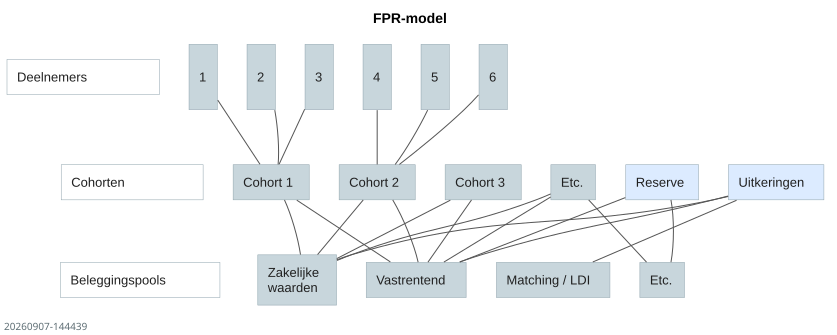
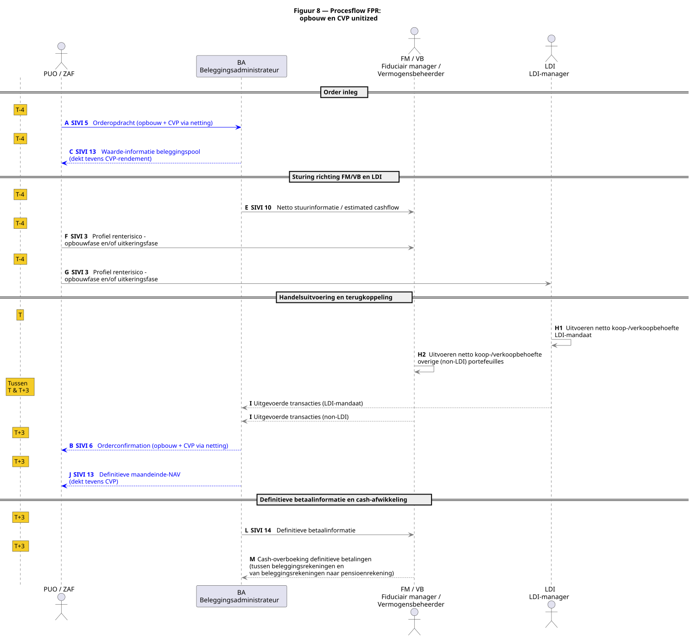
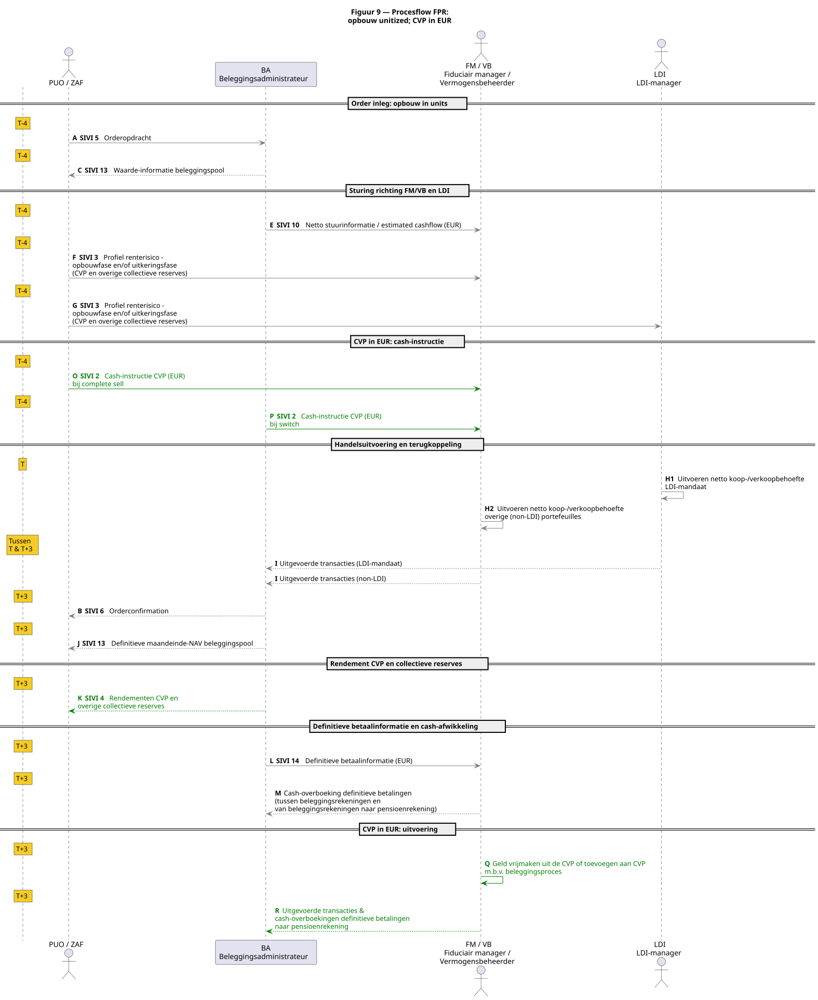
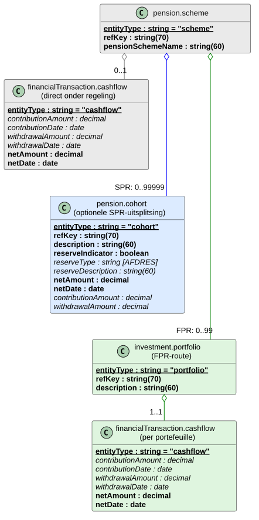
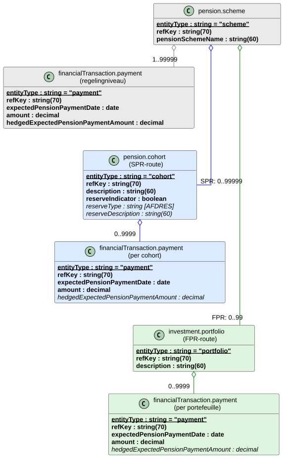
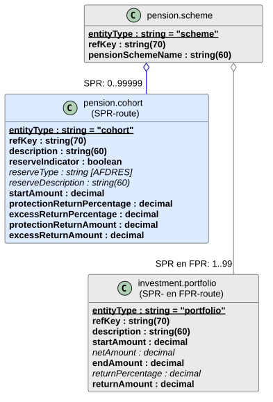

# 4 Processes & Information Flows – Flexible Premium Scheme

## 4.1 Introduction

This chapter describes the exchange of information between the parties involved that is needed to implement the Flexible Premium Scheme in a robust way. The required data set has been determined on the basis of the principles and the scope.

The process of the flexible premium scheme is controlled according to one FPR model for "ordering" investments, which is applied in the operational cooperation between pension administration and asset management. Earlier releases distinguished between a simpler, direct order model and a more extensive, layered order model. That distinction has been dropped: the data exchange is the same in both cases.

A model is also conceivable in which the SPR data model can be used for the FPR data exchange. In this model, FPR is set up in a way comparable to SPR, in effect only supporting multiple risk profiles per cohort.

Within a Flexible Premium Scheme (FPR), there are, in addition to the individual, 'unitized' money flows, also collective premium flows. These are money flows that do not belong to one specific participant, such as risk premiums, contributions to reserves, or withdrawals from a collective payout pool.

The standard FPR messages (5 to 15) are aimed purely at the unitized world and do not support these collective flows. To solve this, the agreement is that parties fall back on the proven SPR messages 1, 2, 3 and/or 4 for the exchange of this information. This method applies throughout the FPR model.

## 4.2 The FPR Model

The FPR model has three layers: participants are assigned to cohorts, and investments are made in investment pools. Participants are assigned to cohorts by the pension administration organisation (PUO).

The allocation from cohort to investment pool lies with the PUO and is not part of the data exchange. Financial events at participant level are aggregated per cohort by the PUO and lead to net orders for the underlying investment pools, in line with the strategic allocation within the cohort[^2]. For the asset management chain the cohort plays no role in this: participants participate through the investment pools. Because the PUO knows that allocation, assets per cohort can be derived from it.

**Figure 2 – The FPR model**
[Full view (SVG)](media/fpr-model.svg){: target="_blank" }

**Investment pool and investment product.** Two layers play a role in this chapter, and we keep them apart:

- **Investment pool**: the administrative unit in which the investments are grouped and for which units and unit values are kept. In the data model this is the entity `investment.pool`.
- **Investment product**: what an investment pool invests in. An investment product is an
    - **investment fund**: with its own fund structure, whether or not tradable through a trading platform; or a
    - **mandate**: an investment mandate given to an asset manager to manage a portfolio according to guidelines and risk limits agreed in advance, not accessible to other investors (see [§8.1](../chapter-8-1-glossary-vbpuo/)).

This manual uses *investment product* where it does not matter whether a fund or a mandate is meant. *Investment fund* and *mandate* are used only where the distinction matters.

**Scope.** The VB-PUO data exchange extends up to and including the investment pools. What happens below them — the underlying investment products, liquid and illiquid, and further trade execution — falls outside this standard. Depending on how the chain is set up, the party that processes an order may be a broker, transfer agent or order desk; that choice does not affect the data exchange.

The investments may consist of:

- investment funds tradable directly through a platform,
- investment funds that are not tradable daily,
- (illiquid) funds that are not tradable through a platform,
- mandates.

Trading platforms are, for example, AllFunds or Fundsettle, where investment funds can be traded directly.

The PUO translates changes at participant level into the required (netted) transactions in the investment products of operational asset managers. When the orders are compiled, aspects such as the minimum order size per investment product, the settlement cycle and the associated financial flows are taken into account.

The pension provider is usually supported by the fiduciary manager (FM) with regard to the design of the lifecycle(s) and their composition (selection and monitoring of underlying investments). The process of changes in the composition of the investments (replacement of investment products) deserves specific attention. Such changes result in transition activities at the PUO and/or the asset service provider/custodian. More specifically: if an investment product is replaced, removed or added, the PUO will adjust and process this. If changes are made *within* an investment product, this is not relevant for the PUO and only affects the provider of the investment product. The exception is the events passed on through message 15 Corporate Actions — dividend, rebate, unit changes — which the PUO does have to process; see [§4.3.10](#4310-message-15-corporate-actions-00557).

**Cohorts**

A cohort is an administrative grouping of participants who, on the basis of the lifecycle principle — less investment and interest rate risk as the retirement date or the end date of the investment horizon approaches — have the same investment allocation. A cohort can be used to distinguish groups of participants. This can be based on time (age, period until retirement, etc.), but also on a status such as active, deferred or unable to work due to disability. The number of cohorts is in principle unlimited: as many are created as are needed to distinguish groups of participants that require their own investment mix. The distribution of the weights (percentages) is usually made by the FM.

Below is a simple example with a division into three lifecycles based on age and the agreed allocation to equities and bonds.

|  | **Lifecycle defensive** |  | **Lifecycle neutral** |  | **Lifecycle aggressive** |  |
|----|----|----|----|----|----|----|
| **Cohort** | % Equities | % Bonds | % Equities | % Bonds | % Equities | % Bonds |
| Age 39 | 90 | 10 | 95 | 5 | 100 | 0 |
| Age 40 | 88 | 12 | 94 | 6 | 98 | 2 |
| Age 41 | 86 | 14 | 93 | 7 | 96 | 4 |
| Age 42 | 85 | 15 | 91 | 9 | 94 | 6 |
| Age 43 | 84 | 16 | 89 | 11 | 92 | 8 |
| Age 44 | 83 | 17 | 87 | 13 | 90 | 10 |
| Age 45 | 82 | 18 | 85 | 15 | 88 | 12 |
| Age 46 | 81 | 19 | 84 | 16 | 86 | 14 |
| Age 47 | 80 | 20 | 82 | 18 | 84 | 16 |

**Figure 3 - Example of cohorts and lifecycles**

The example in Figure 3 shows how the age of a participant affects the allocation of investments within lifecycles.

When a participant becomes a year older, a so-called age rebalance is carried out, in which the participant is placed in the next cohort.

The participant's investment mix is then adjusted to that of the new cohort. In the example above (Figure 3), regardless of the chosen risk profile, the share of equities is reduced and the share of bonds is built up. This therefore leads to concrete buy and sell orders towards the product providers.

Another form of rebalancing is target weight rebalancing. This can be carried out when the actual allocation of investments falls outside predetermined bandwidths as a result of price movements. This form of rebalancing also leads to buy and sell orders.

A group (cohort) of participants can be composed in various ways. In general, 3 aspects play a role:

- Age.

- Status.

- Investment profile.

For the age aspect, for example, use can be made of:

- Age.

- Period until retirement date/end date of the investment horizon.

- Year/month of birth.

For status, a distinction can be made between:

- Accumulating versus receiving benefits.

- Active/Deferred/Occupationally disabled (AO)/Receiving benefits/etc.

Netting of the investments takes place across the cohorts in accordance with the instructions for the investment transactions. The risk-sharing reserve is regarded as a separate cohort that invests in investment products according to its own investment policy.

**Roles and responsibilities**

Participants participate in cohorts according to the chosen lifecycle and the chosen composition of cohorts. The PUO aggregates the changes at participant level per cohort and translates them into net orders in one or more investment pools, in line with the strategic allocation within the cohort[^2]. The investment administrator (BA) does not know that allocation and does not need to know it: the BA is instructed by the PUO with purchases and sales in the investment pools or directly in investment products. These investment pools invest in a variety of investment products, liquid and illiquid. To make the allocation to participants robust and traceable, units are issued and unit values are calculated for the investment pools. The participant's assets can therefore be traced exactly to the pro rata share of the underlying investments. Figure 3 also serves as a simple example here, with "% Equities" and "% Bonds" replaced by, for example, "% Real assets", "% Fixed income, short maturities", "% Fixed income, long maturities", etc.

Four roles can be distinguished in that process — the same four that appear in the process flow of §4.3.1 and in Figure 8 and Figure 9.

- The **PUO** is responsible for allocating the asset development, in accordance with the allocation rules set by the pension provider, to: the personal pension assets of participants, the risk-sharing reserve, any compensation deposit and possibly other reserves. To this end, the PUO processes changes in the participant file and the allocation of personal pension assets to cohorts. The composition of the cohorts takes into account the lifecycle the participant has chosen (aggressive, neutral, defensive, etc.). Premiums paid in and possible settlements, such as with the risk-sharing reserve, are also taken into account. On the basis of these personal pension assets, benefits are projected in accordance with the principles of the pension provider. In addition, the PUO takes care of participant communication.

- The **investment administrator (BA)**, also called asset service provider, keeps the independent investment administration of the investment pools for the pension provider. That administration has two layers:

    - **the positions**: the BA records which investments are in the investment pool and to what extent. That record is fed from the settlement of changes in those investments, carried out by the operational asset managers instructed by the FM, and reconciled[^4] with the (shadow) administration of the FM;
    - **the units**: the BA keeps the administration of the investment pools (for example real assets, fixed income), on the basis of the instructions of the PUO. For this purpose, unit values are calculated for the investment pools and the number of units is administered. Premiums, withdrawals and rebalancing are taken into account. The unit values and the number of units form the basis for the PUO to allocate assets explicitly to participants.

- The **fiduciary manager / asset manager (FM/VB)** supports the pension provider in drawing up the integral investment policy and takes care of its implementation. In doing so, the FM directs the operational asset managers, who manage parts of the portfolio. The FM will also keep a (shadow) investment administration.

- The **LDI manager** carries out the interest rate risk policy on the LDI mandate, aimed at the protection return, and is monitored by the FM/VB in doing so.

This division of roles is not prescriptive: in an alternative set-up, roles can be performed by one and the same party. See [§2.5](../chapter-2-principles/#25-clarification-of-data-exchange-principles).

**Return allocation.** The allocation of returns can be done by the PUO or by the investment administrator. Whether the return is allocated explicitly depends on the set-up. In a unitized set-up, the return is included in the unit price; there is then no explicit return allocation, and the BA periodically shares the valuation of the investment pools with the PUO via message 13. If the collective payout provision is administered in euros, the return is allocated explicitly, via message 4.

**Accumulation phase and payout phase**

The FPR process distinguishes between an accumulation phase and a payout phase.

Insofar as the payout phase has been placed entirely with an insurer, the data exchange is out of scope of this elaboration of the data exchange. In that case the insurer receives the participant's capital by means of an outgoing value transfer from the PUO, with which a pension benefit is purchased from the insurer.

The payout phase carried out by a PUO is in scope. In the payout phase, participants can choose between continued investment (with a variable pension benefit) or a fixed pension benefit. With a variable benefit, the pension fund can choose a model with an individual payout phase or a collective payout phase.

With an individual payout phase, the data exchange for the continued-investment variant can be set up in the same way as for the accumulation phase (with, for example, more investment in shorter fixed-income securities at a higher age).

With a collective payout phase (all retirees in one cohort), for both fixed and variable benefits, it is important that the interest rate sensitivity of the investments (in a matching portfolio) matches the collective interest rate sensitivity of the projected benefits. It is possible to choose to continue investing individually in the payout phase and to switch to a collective payout phase later. This switch has no impact on the data fields and/or the data exchange between parties.

For the payout phase, the FM will set up (the management of) a matching portfolio. For the required data exchange, the PUO sends the projected benefits to be hedged per cohort to the FM per scheme on a periodic basis (expected to be monthly). The data exchange for this will be set up in accordance with data exchange 1c from the SPR.

## 4.3 FPR Information Flows

The data exchange within the FPR model takes place through the messages described in this section. Which party sends and receives which message is laid down per role; see Table 12 in [§6.4](../chapter-6-4-messages/). A role can be performed by different parties — a PUO can, for example, perform the role of investment administrator — but that does not change the information flow.

The two process diagrams in §4.3.1 first give the overview; the messages then follow in ascending message number. Messages 2, 3 and 4 are SPR messages that are reused within FPR: 2 and 4 for the flows that do not run through the unit administration, 3 for the interest rate risk profile towards the FM/VB and the LDI manager; see [§4.1](#41-introduction) for the background. Messages 5 to 15 form the FPR's own message set. Of these, messages 7, 8, 9, 11 and 12 have been discontinued as of release 2027; they are listed, with the reason, in [§4.3.11](#4311-discontinued-messages).

### 4.3.1 FPR Process Flow

This section gives the overview of the FPR process flow. The standardised data exchanges are shown in the figures as arrows, with the message numbers next to them. Which data each information flow carries is set out in the message sections that follow.

Note: Figure 8 and Figure 9 are indicative process flow diagrams. The time indications are indicative and can be filled in differently per client chain between all parties involved; the order of the steps is, however, guiding. This document is only about the information flows. Timing, frequency and whether a message is delivered as provisional, final or in both forms are laid down by the parties in agreements between chain parties (TOM / SLA).

Figure 8 and Figure 9 do **not show different FPR models**. They show two administrative set-ups of the accumulation phase and the collective payout phase (CVP)[^3]:

| | Accumulation phase | CVP |
|---|---|---|
| **Figure 8** | unitized | unitized |
| **Figure 9** | unitized | in EUR |

The accumulation phase is unitized in both cases. The difference lies solely in the administrative representation of the CVP: in units, or in euros. That choice determines which additional information flows are needed.

The process flow has four actors: PUO, BA (investment administrator), FM/VB (fiduciary manager/asset manager) and LDI manager. In this context, PUO also includes the self-administering fund (ZAF).

**What the diagrams do not show.** Figure 8 and Figure 9 show one run of the trading cycle for one administrative set-up. Outside of that, exchanges take place that are not shown. A message can be sent to more than one recipient, each with its own endpoint and identification, and with a purpose that can differ per recipient; see [§2.4](../chapter-2-principles/#24-principles-of-data-exchange). Additional deliveries of the same message also have no step of their own in the diagrams.

**Step letters.** Figure 8 and Figure 9 share their step letters: the same letter stands for the same step in both figures. If a letter is missing in a figure, that step does not occur in that set-up. Figure 8, for example, has no step K, because the return of the CVP is included in the unit value there and does not require a separate message 4.

**Message 15 is not in the process diagrams.** Corporate actions follow their own rhythm and fall outside the trading run from T-4 up to and including T+3. Including the message in Figure 8 and 9 would suggest a time relationship with the trading cycle that does not exist. See [§4.3.10](#4310-message-15-corporate-actions-00557).

**Figure 8 — FPR process flow: accumulation and CVP unitized**
[Full view (SVG)](media/image8.svg){: target="_blank" }

**Explanation of Figure 8: accumulation and CVP unitized**

Here the investment flows of the accumulation phase and the CVP are combined through netting. The CVP is administered in units, so the same order flows (SIVI 5/6) cover both accumulation and CVP changes.

**Colour coding:** grey arrows are generic flows that are identical in both figures. Blue arrows mark flows that have a broader meaning here because they cover both accumulation and CVP. The time indications (T-4, T, T+3) are indicative; T is the moment of trading.

**Phase 1 — Order input (T-4):**
The PUO sends an order instruction (SIVI 5, step A) to the BA. The same day, the BA delivers the value information of the investment pool (SIVI 13, step C), which here also covers the CVP return. That price information is needed to express the order in units.

**Phase 2 — Direction towards FM/VB and LDI (T-4):**
The BA sends net control information (SIVI 10, step E) to the FM/VB. The PUO sends the interest rate risk profile (SIVI 3 — message 3, Pension Projection, steps F and G) to the FM/VB and the LDI manager.

**Phase 3 — Trade execution, feedback and payment information (T to T+3):**
On T, the LDI manager executes the net buy/sell requirement on the LDI mandate (step H1), aimed at the protection return. The FM/VB monitors the LDI manager and executes the net buy/sell requirement on the other (non-LDI) investment portfolios (step H2). Executed transactions are reported back to the BA (step I).

On T+3 the feedback to the PUO follows: first the order confirmation (SIVI 6, step B), then the final month-end NAV (SIVI 13, step J). On that basis the BA sends the final payment information to the FM (SIVI 14, step L), after which the FM takes care of the cash settlement (step M).

**On reporting back executed transactions.** Steps I and M carry no channel name. In practice this is usually done via SWIFT, but the standard does not prescribe it: not all instruments are reported back that way — swaps, for example, are handled differently. Which channel chain parties use for this is a matter of mutual agreement and falls outside the VB-PUO data exchange.

**Sender of messages 10 and 14.** These messages are sent by the BA role. The PUO/ZAF sends them only when it performs the role of investment administrator itself. The role matrix in [§6.4](../chapter-6-4-messages/) therefore lists only the BA as sender. See GitHub issue [#142](https://github.com/Stichting-SIVI/VBPUOdsk/issues/142).

**Why there is no separate CVP valuation here.** Because the CVP runs along in the same unit administration through netting, step J covers both the investment pool and the CVP. No further trading takes place after step M, so a second valuation message is not needed. In Figure 9 this is different: there the CVP has its own execution cycle and therefore its own valuation.

**Figure 9 — FPR process flow: accumulation unitized; CVP in EUR**
[Full view (SVG)](media/image9.svg){: target="_blank" }

**Explanation of Figure 9: accumulation unitized; CVP in EUR**

Here the CVP is administered not in units but in euros, while the accumulation phase does remain unitized. This leads to additional information flows, because the return and cash flows of the CVP do not run along through the unit administration.

What is said here about the CVP applies in the same way to other collective parts administered in euros: the risk-sharing reserve, any compensation deposit and other reserves and provisions. They too require a separate cash instruction and a separate statement of returns, for the same reason.

**Colour coding:** grey arrows are generic flows (see Figure 8 for the complete colour coding). Green arrows mark the flows that are specific to a CVP in EUR.

The accumulation phase (steps A to J) runs in the same way as in Figure 8. The difference lies in the additional green flows:

- **Cash instruction CVP** (steps O and P, T-4): cash instructions in EUR go to the FM/VB via SIVI 2, at the same time as the order instruction (SIVI 5). Who sends that instruction depends on the nature of the change. In the case of a **switch** — assets move from the accumulation phase to the CVP and the total invested assets do not change — the BA sends the instruction; after all, it knows both sides of the switch. In the case of a **complete sell** — assets leave the chain, for example on a benefit payment or an outgoing value transfer — the PUO sends the instruction. Both situations occur in practice.

    The EUR order for the CVP therefore does **not** go through the order instruction (SIVI 5). Message 5 concerns the unitized orders in the investment pools; the FM/VB is informed of the upcoming cash flow for the non-unitized parts through the cash instruction (SIVI 2 — message 2, Cashflow). See also [§4.1](#41-introduction).
- **Return CVP** (step K): the BA sends returns for the CVP and other collective reserves to the PUO via SIVI 4.
- **Investment process CVP** (step Q): the FM/VB releases money from or adds money to the CVP through the investment process.
- **Feedback CVP** (step R): executed transactions and cash transfers to the pension account are reported back to the BA.

**No separate valuation message after the CVP execution.** Although the CVP has its own execution cycle (steps Q and R), no valuation message (SIVI 13) follows for the CVP in EUR. After all, the CVP is not administered in units, so there is no unit value to pass on. The return on the CVP reaches the PUO via SIVI 4 (step K).

### 4.3.2 Message 2. Cashflow (0001b)

**Information flow from PUO or BA to FM/VB**

Message 2 is an SPR message that is reused within FPR for periodic cash flow information. It is used for those money flows that do not run through the unit administration — in particular the collective flows. Who sends the message depends on the change: in the case of a **switch** the BA, in the case of a **complete sell** the PUO (see [§4.3.1](#431-fpr-process-flow), *Cash instruction CVP*). See also [§4.1](#41-introduction).

**Purpose and meaning**

The message reports the expected or established net cash flow per investment portfolio, so that the receiving party can arrange liquidity for it. This concerns both benefit payments and transfers of assets from the accumulation phase to the collective payout provision (CVP) or to reserves.

**Population pattern within FPR**

For FPR use, the cash flow per investment portfolio runs via `pension.scheme → investment.portfolio → financialTransaction.cashflow`. In this population pattern, `netAmount` and `netDate` are mandatory at portfolio level. The SPR route (cash flow directly under `pension.scheme`, with a breakdown via `pension.cohort`) and the FPR route are mutually exclusive. See [§6.3.1](../chapter-6-functional-specs/#consistency-checks-cashflow-message-0001b) for the consistency checks and [§6.4.3](../chapter-6-4-messages/#643-message-structure-2-cashflow-0001b) for the message structure.

In addition to the cash flow per portfolio, the cash flow directly under the scheme can carry the total; it applies in both routes. The amounts and dates of inflow and outflow are optional in every cash flow block; `netAmount` and `netDate` are mandatory everywhere. The investment portfolio carries no reserve fields. See [§3.2.5](../chapter-3-spr-processes/#325-spr-and-fpr-route-in-messages-2-3-and-4) for messages 2, 3 and 4 together.

**Figure 1a — Message 2 Cashflow (0001b): SPR and FPR route** (see also [§3.2.2](../chapter-3-spr-processes/#322-message-2-cashflow-1b-inflow-and-outflow))
[Full view (SVG)](media/figuur1a-bericht2-cashflow-routes.svg){: target="_blank" }

The FPR route is green: exactly one cash flow per investment portfolio. Grey applies to both routes, blue is the SPR route. Fields in bold are mandatory, fields in italics optional. The figure shows only the fields that matter for the routes; the full message structure is in [§6.4.3](../chapter-6-4-messages/#643-message-structure-2-cashflow-0001b).

**Relationship with messages 5, 10 and 14**

Message 2 and the order chain do two different things. The order chain — message 5 (order instruction), message 10 (control information) and message 14 (payment information) — concerns the unitized flows: these are administered in units per investment pool and lead to orders and the associated settlement. Message 2, on the other hand, concerns the flows that are *not* unitized and therefore do not result in an order in an investment pool. The two complement each other; they are not alternatives to each other.

**Expected or established cash flow**

Message 2 can carry either an expected or an established net cash flow. [§3.2.2](../chapter-3-spr-processes/#322-message-2-cashflow-1b-inflow-and-outflow) describes these two applications — forward-looking for liquidity management, backward-looking for analysis and accountability — and states that in practice they can exist side by side. Within FPR this applies in full. Which application a chain uses, at what moment and with what frequency, is laid down by the parties in agreements between chain parties (TOM / SLA). The position at T-4 in the process diagrams fits the forward-looking application and is indicative.

**Sequence, not timing.** In the process diagrams, message 2 is at T-4 (Figure 9, steps O and P). That fits the forward-looking application: an expected cash flow does not require settlement in advance. If it concerns assets transferred from the accumulation phase to the CVP, the final amount only arises from the settlement of the unit sale — in the diagrams at T+3, where the order confirmation (step B) and the final month-end NAV (step J) are. An established statement therefore follows those steps.

A chain may deviate from the timing itself; it may not deviate from that sequence. The diagrams show only the forward-looking delivery — see *What the diagrams do not show* in [§4.3.1](#431-fpr-process-flow).

### 4.3.3 Message 3. Pension Projection (0001c)

**Information flow from PUO to FM/VB and LDI manager**

Message 3 is also an SPR message that is reused within FPR. In the process flow, the PUO uses it to deliver the interest rate risk profile to the FM/VB and the LDI manager (Figure 8 and 9, steps F and G). For its purpose, see [§3.2.3](../chapter-3-spr-processes/#323-message-3-pension-projection-1c-projected-benefits).

**Population pattern within FPR**

In FPR, the projected benefits can be delivered per investment portfolio, via `pension.scheme → investment.portfolio → financialTransaction.payment`. The portfolio branch is intended for schemes in which several investment portfolios are distinguished. Per portfolio, the same payment data are given as per cohort; reserve fields are not on the portfolio. The payments directly under the scheme are scheme totals and apply in both routes. See [§3.2.5](../chapter-3-spr-processes/#325-spr-and-fpr-route-in-messages-2-3-and-4) for the relationship with the SPR route.

**Figure 9a — Message 3 Pension Projection (0001c): SPR and FPR route**
[Full view (SVG)](media/figuur9a-bericht3-pensioenprojectie-routes.svg){: target="_blank" }

The FPR route is green: the payments per investment portfolio. Grey applies to both routes, blue is the SPR route. Fields in bold are mandatory, fields in italics optional. The figure shows only the fields that matter for the routes. See GitHub issue [#113](https://github.com/Stichting-SIVI/VBPUOdsk/issues/113).

Functional specification per message: see chapter 6 and in particular [§6.4.4](../chapter-6-4-messages/#644-message-structure-3-pension-projection-0001c).

### 4.3.4 Message 4. Return Information (00002)

**Information flow from BA to PUO**

Message 4 is also an SPR message that is reused within FPR. It passes on the return achieved on the part of the assets for which the return is not already included in a unit value.

**Purpose and meaning**

In a unitized set-up, message 4 is not needed: the return is included in the unit price, and message 13 passes that price on. Message 4 is intended for the collective parts administered in euros — the collective payout provision, the risk-sharing reserve and any other reserves and provisions — where the return does have to be allocated explicitly. Message 13 cannot replace it there: without a unit administration there is no unit value to pass on.

Whether a chain uses message 4 therefore depends on the set-up. Figure 8 and 9 show both variants: with a unitized CVP, message 4 does not occur; with a CVP in euros it does (step K). [§3.2.4](../chapter-3-spr-processes/#324-message-4-return-information-2-information-need-of-the-puo) makes the same point from the SPR side: the exchange of returns can also be used in a specific implementation variant of the flexible premium scheme.

**Figure 9b — Message 4 Return Information (00002): SPR and FPR route**
[Full view (SVG)](media/figuur9b-bericht4-rendementsinformatie-routes.svg){: target="_blank" }

In message 4 the investment portfolio is grey: it applies to both routes, with at least one and at most 99 portfolios per scheme. The breakdown per cohort (blue) is optional. Fields in bold are mandatory, fields in italics optional. The figure shows only the fields that matter for the routes.

Functional specification per message: see chapter 6 and in particular [§6.4.5](../chapter-6-4-messages/#645-message-structure-4-return-information-00002).

### 4.3.5 Message 5. Order Instruction (00541)

**Information flow from PUO to BA**

This information flow contains the minimum set of data needed to send an order to the order-processing party. It can also be used to carry out a switch.

The PUO submits orders at the level of the investment product. The provider of the product carries out the ordering in the underlying investments itself. That is a different role from the order-processing party, which handles the order of the PUO and may be, for example, a broker, transfer agent or order desk. This may concern, among other things, listed and illiquid investments.

**Switch convention.** A switch consists of two linked orders: one with `buySellId` = `switchfrom` (the investment product being left) and one with `buySellId` = `switchto` (the investment product being switched to). The direction of the transaction follows solely from `buySellId`; `tradeAmount` and `tradeQuantity` are always given as positive values. The two switch legs are linked to each other through `financialInformationRef`, which refers to the `refKey` of the other leg. The field `switchType` indicates whether it is a sequential (`1`) or simultaneous (`2`, one-day) switch (code list AFDSWI). See GitHub issue [#115](https://github.com/Stichting-SIVI/VBPUOdsk/issues/115).

**Order instruction: `tradeAmount` or `tradeQuantity`.** Per individual trade instruction, exactly one of `tradeAmount` or `tradeQuantity` must be filled. Filling both fields at the same time is not allowed; leaving both empty is not allowed either, except for the leg of a switch that does not drive the switch (see below). If an instruction has both an amount and a quantity component, these are recorded as separate trade records. See GitHub issue [#116](https://github.com/Stichting-SIVI/VBPUOdsk/issues/116).

**In a switch, one of the two legs drives.** A switch consists of two linked orders, and only one of them is actually instructed; the other follows from it. If you instruct *"move 20 units out of product A"*, the `switchfrom` leg carries `tradeQuantity` and the `switchto` leg stays empty: how many units are obtained in the receiving product depends on the proceeds and on the price at the moment of execution, and cannot be determined at the time of instruction. Conversely, if you instruct *"invest € 3,000 in product B"*, the `switchto` leg carries the amount and the `switchfrom` leg stays empty. Hence the rule: **per switch pair, exactly one leg carries exactly one of the two fields, and the other leg carries neither.** Which leg is filled itself indicates which side drives the switch; a separate field for this is not needed.

**Switches in practice.** In practice, message 5 is mainly used to withdraw a number of units from an investment product at the transition from the accumulation phase to the collective payout phase (CVP). The `switchfrom` leg then carries the number of units (`tradeQuantity`); the `switchto` leg stays empty. The money value of those units is not in message 5, but follows through message 6.

**This rule does not apply in message 6.** An order confirmation reports what has been executed, and then quantity, price and amount are all three known. There, `tradeQuantity`, `tradePrice` and `tradeAmount` usually occur together; if quantity and price both occur, `tradeQuantity × tradePrice = tradeAmount` applies (see §6.3.2). In a switch this is also the link between the two legs: the amount that comes out of the `switchfrom` leg goes into the `switchto` leg. The consistency checks of messages 5 and 6 are together in [§6.3.2](../chapter-6-functional-specs/#consistency-checks-order-instruction-order-confirmation).

Functional specification per message: see chapter 6 and in particular *6.4.6*.

### 4.3.6 Message 6. Order Confirmation (00542)

**Information flow from BA to PUO**

The confirmation data of the order come back from the order-processing party to the PUO. For switches, message 6 confirms the same structure as message 5, including `switchType` and `financialInformationRef`. See GitHub issue [#115](https://github.com/Stichting-SIVI/VBPUOdsk/issues/115).

Functional specification per message: see chapter 6 and in particular *6.4.7*.

### 4.3.7 Message 10. Control Information Investment Pools (00553)

**Information flow from BA to FM**

**Purpose and meaning**

Message 10 gives the fiduciary manager the net control information per investment pool: what needs to be added or taken out on balance, so that the FM/VB can direct the underlying investments. Where message 5 is an instruction to the administration, message 10 is a signal to the investment process.

Message 10 is sent by the investment administrator. The PUO sends it only when it performs the role of investment administrator itself (see *Sender of messages 10 and 14* in [§4.3.1](#431-fpr-process-flow)). It receives the information needed for this from the PUO via message 5 (Order Instruction).

**From message 5 to message 10**

There is a translation step between the two messages, which the BA carries out:

- **From instruction to balance.** Message 5 contains the individual order instructions. The BA nets them per investment pool into one net buy or sell requirement. Instructions that cancel each other out therefore do not reach the investment process.
- **From units to amounts.** Message 5 can instruct either by amount (`tradeAmount`) or by number of units (`tradeQuantity`). Message 10 expresses the requirement as an amount, for which the BA uses the unit value from message 13.
- **Switches largely drop out.** A switch consists of a `switchfrom` and a `switchto` leg. If they concern the same investment pool, they net out and the switch produces no control information. Only when the legs affect different pools does a net requirement remain.

See also the explanation of Figure 8 and 9 (step E). Functional specification: see *§6.4.8*.

### 4.3.8 Message 13. Value Information Investment Pool (00555b)

See the explanation of Figure 8 and 9 (steps C and J).

**Information flow from BA to PUO**

**Purpose and meaning**

Message 13 is the message on which the entire unitized administration rests. Without a unit value, the PUO cannot allocate assets to participants, cannot convert an order into units and cannot reconcile a payment. The message is therefore not feedback after the fact but a precondition beforehand: the other parties can only proceed once the BA has issued the valuation.

Message 13 passes on the valuation of the investment pools. With it, the investment administrator makes the unit values and the administrative price of the investment pools available to the parties involved, so that they can carry out their administration, valuation and further processing.

Per investment pool, the message contains the ID (`refKey`) and the description (`description`), the value per investment pool (`unitsSummedValueAmount`), the net asset value per unit (`preliminaryUnitValueAmount`), the number of units issued (`numberOfUnits`) and the currency of the pool (`currencyType`).

This message occurs twice in the process flow. At T-4 it delivers the value information of the investment pool (Figure 8 and 9, step C); at T+3 the final month-end NAV (step J). Message 13 thus provides both the **price information** needed to form orders and the final valuation on which the **reconciliation** and the payment information are based.

Functional specification: see *§6.4.9*.

### 4.3.9 Message 14. Payment Information (00556)

**Information flow from BA to FM**

**Purpose and meaning**

Message 14 is sent by the investment administrator. The PUO sends it only when it performs the role of investment administrator itself. Per scheme, the message contains at least one and at most 999 payments (`financialTransaction.payment`). See GitHub issue [#149](https://github.com/Stichting-SIVI/VBPUOdsk/issues/149). Message 14 concludes the trading cycle. Once the final month-end NAV is known (message 13, step J), the investment administrator determines which amount actually has to be transferred and to whom. The message is thus the bridge between the administration and the actual money flow: where messages 5 and 10 are about what has to happen, message 14 is about what has happened and what is being paid.

For the FM, the message is the basis for the cash transfer of the final payments (step M).

See the explanation of Figure 8 and 9 (step L). Functional specification: see *§6.4.10*.

### 4.3.10 Message 15. Corporate Actions (00557)

**Information flow from the asset management chain to the PUO**

Message 15 is an ad hoc message: it is not part of the regular monthly flow and is therefore not in Figure 8 and 9. Message 15 is used to pass on corporate action events on investment products from the asset management chain to the pension administration organisation (PUO). The message is intended for situations in which such events are processed within the asset management administration, but are not automatically visible in the administration of the PUO.

The information is delivered by the party within the asset management chain that is responsible for recording the event concerned. Depending on how the chain is set up, this can be, for example, a BA, FM or other asset management party.

**Scope.** The message belongs to the set-up in which investment funds tradable directly through a trading platform are traded; see [§4.2](#42-the-fpr-model). Corporate actions do not apply to the investment pools themselves — they occur on the underlying investment products.

The message is primarily intended for:

- cash dividend;
- rebate;
- increase or decrease of units;
- capital and unit shifts as a result of collateral calls or collateral returns;
- corrections to corporate actions sent earlier.

In addition, the message can be used for additional changes related to corporate actions, such as product changes or other administrative adjustments, insofar as these fall within the agreed implementation of message 15.

This enables the PUO to:

- keep its own administration in sync with the asset management administration;
- process money and unit changes correctly;
- record corporate action events administratively;
- prevent differences between the PUO and asset management administrations.

**Modelling of rebate**

A rebate is modelled as a corporate action with `corporateActionType` = `99` (*Other*, code list AFDCOA). A separate code for rebate is not yet available in AFDCOA at the time of writing. The rebate amount is recorded in `cashDividendTotalAmount` and/or `cashDividendPerUnitAmount`, the same attributes as for a cash dividend (`corporateActionType` = `1`). As long as rebate has no code of its own, a rebate cannot be distinguished in the message from other corporate actions with code `99`. See GitHub issue [#137](https://github.com/Stichting-SIVI/VBPUOdsk/issues/137).

AFDCOA currently has the codes `1` Cash dividend, `2` Stock dividend, `3` Product change and `99` Other.

Functional specification per message: see chapter 6 and in particular *6.4.11*.

See GitHub issue [#87](https://github.com/Stichting-SIVI/VBPUOdsk/issues/87).

### 4.3.11 Discontinued Messages

Five messages from earlier releases are no longer active as of release 2027. They are listed together here, so that the description of the active messages above remains readable as one whole. The message numbering has been left unchanged: numbers 7, 8, 9, 11 and 12 will not be issued again.

| Message | Description | Why discontinued |
|---|---|---|
| 7 (00551) | Balance Adjustments — information need of the cohort pool and investment pool administrator | The cohort pool as an administrative layer has been dropped; the data land directly at investment pool level. |
| 8 (00552a) | Reconciliation Information | Belonged to the role of cohort pool administrator, which has been dropped as an independent actor. |
| 9 (00552b) | PUO Reconciliation Information | Idem; additional flow for the case in which the PUO performed that role. |
| 11 (00554) | Rebalancing Information — rebalancing of cohort pools | Rebalancing at cohort pool level no longer exists. |
| 12 (00555a) | Value Information Cohort Pool | Replaced by message 13, which gives the value at investment pool level. |

See GitHub issues [#99](https://github.com/Stichting-SIVI/VBPUOdsk/issues/99), [#119](https://github.com/Stichting-SIVI/VBPUOdsk/issues/119) and [#121](https://github.com/Stichting-SIVI/VBPUOdsk/issues/121).

The message schema can still support these exchanges if desired; they are simply no longer part of the active message set.

## 4.4 Feedback Message (& Resending)

**Purpose and Function**

When exchanging messages, it is essential that the sender knows whether a message has been received and processed correctly. The feedback message has been developed to provide this certainty in the following situations:

- In asynchronous processing: to report back the final status (both success and error) of a message after processing in the background has been completed.

- In synchronous processing: to return immediate, detailed error information when a message cannot be accepted.

A feedback message is therefore always used to specify errors. In the case of successful processing, it is only sent as part of an asynchronous process. In the case of successful synchronous processing, an HTTP 200 OK status code is sufficient.

**Structure of the Feedback Message**

The feedback message has a compact, fixed structure optimised for reporting status information. The image below (also available on GitHub under [message overview](https://github.com/Stichting-SIVI/VBPUOdsk/wiki/Berichtenoverzicht#feedback-message) and in the [MessageStructureView](https://github.com/Stichting-SIVI/VBPUOdsk/tree/main/VBPUO_Feedback_Message/MessageStructureView) of the message) shows the hierarchical structure and the most important entities.

The core of the message is formed by the following components:

- commonTechnical: Contains the technical identification of the feedback message itself, such as a new, unique `messageId`. In addition, a `party` block can optionally be included with information about the sender and receiver of the message, to support routing and for consistency with other `commonTechnical` structures ([#90](https://github.com/Stichting-SIVI/VBPUOdsk/issues/90)).

- commonFunctional: Contains the functional metadata, including:

  - statusType: The status of the original message: Accepted (8) or Rejected (0).

  - originalMessageId: A mandatory reference to the `messageId` of the message to which this feedback relates.

  - originalMessageType: An optional field indicating the type of the original message, to simplify routing at the recipient.

- error: An optional block that, in the case of rejection, contains an `errorCode` and an `errorCodeExplanation`.

- party.pensionProvider: Identifies the pension provider to which the original message related.

*For a detailed specification of all attributes and code lists, see sections 6.5 and 6.4.12.*

**Interaction Patterns and Process Flow**

The technical handling of the feedback is laid down in the OpenAPI Specification (OAS) and follows six fixed scenarios. These describe both synchronous and asynchronous processing, including the handling of errors and "panic" situations in which the feedback loop itself fails.

*A visual overview of these scenarios can be found on GitHub: [Feedback activity diagram](https://github.com/Stichting-SIVI/VBPUOdsk/wiki/Feedback-%28Error%29-handling---activity-diagram).*

*The scenarios are explained functionally below.*

1.  Synchronous validation - Success: immediate 200 OK.

2.  Synchronous validation - Error: immediate 400 Bad Request with a feedback message in the body.

3.  Asynchronous validation - Success: first 202 Accepted, later followed by a callback with an "Accepted" feedback message.

4.  Asynchronous validation - Error: first 202 Accepted, later followed by a callback with a "Rejected" feedback message.

5.  Panic scenario (after Error): the callback with "Rejected" feedback is not accepted by the recipient (400 Bad Request).

6.  Panic scenario (after Success): the callback with "Accepted" feedback is not accepted by the recipient (400 Bad Request).

In panic scenarios (5 and 6), manual coordination through another channel is necessary.

**Protocol for Corrections and Resending**

The feedback mechanism dictates the protocol for correcting messages. This protocol is based on the fundamental principle:

**"Once accepted, messages are not corrected unilaterally."**

The feedback message received is the primary form of communication that determines how a correction is to be handled.

**Scenario 1: Correction after an Error Message (Feedback "Rejected")**  
If the receiving party has sent a feedback message with the status "Rejected", this serves as the official request for correction.

- The receiving party expects a new, corrected message.

- The sending party may and must send a corrected message without further, separate coordination.

**Scenario 2: Correction after Acceptance of a message**

This scenario occurs when a message has been accepted successfully (via a 200 OK) and the sending party discovers an error afterwards. Because there is no official trigger for a correction, unilaterally sending a new version of the message (a correction message) is <u>not allowed</u>.

A message with a messageId that has already been used is treated by the receiving party as a duplicate message. This concerns, for example, reuse of an existing messageId or a network retry of a message processed earlier. The exception is chunking: chunks of the same logical message share the same messageId (see [§7.6](../chapter-7-6-chunking/)).

A duplicate message is rejected with:
- HTTP 400 Bad Request
- a Feedback message in the response body

The Feedback message contains at least:
- originalMessageId
- statusType = Rejected (0)
- errorCode
- errorCodeExplanation

The errorCode identifies the type of error. The errorCodeExplanation describes that the messageId has already been used or is not unique.

In such situations, the sending party must contact the receiving party to discuss the situation. The outcome of that consultation determines the follow-up action. Possible solutions are:

- Ad hoc agreement to resend.
- Correction in the next regular delivery.
- Following an agreed incident procedure.

**Functional failure in order processing**

An order that cannot be executed functionally — for example because of an unknown fund or an invalid combination of instruction fields — is reported back by the receiving party via the feedback message. The feedback message contains:

- statusType = Rejected (0)
- an errorCode that classifies the type of failure
- an errorCodeExplanation with a readable explanation

The feedback follows the synchronous or asynchronous interaction patterns as described above. See GitHub issue [#132](https://github.com/Stichting-SIVI/VBPUOdsk/issues/132).

**Force majeure and time limits**

Situations of force majeure fall outside the scope of the VB-PUO standard. The standard does not provide for a separate message or status code for force majeure; handling it is a matter of bilateral agreements between chain parties, for example in an SLA or TOM.

In addition, the standard does not lay down normative time limits for feedback. The speed with which a feedback message is sent after receipt of a substantive message is a subject of operational agreements between the parties involved. See GitHub issue [#132](https://github.com/Stichting-SIVI/VBPUOdsk/issues/132).

[^2]: For example, within cohort A the (strategic) allocation of the investments may be 30% investment pool I and 70% investment pool II. For cohort B that allocation may be 40:60.

[^3]: The process diagrams can be opened in large format via the link *Full view (SVG)* under each figure.

[^4]: Reconciliation between FM and BA is not in scope of the data exchange, but reconciliation between the BA, the FM and the PUO is in scope of the data exchange.
